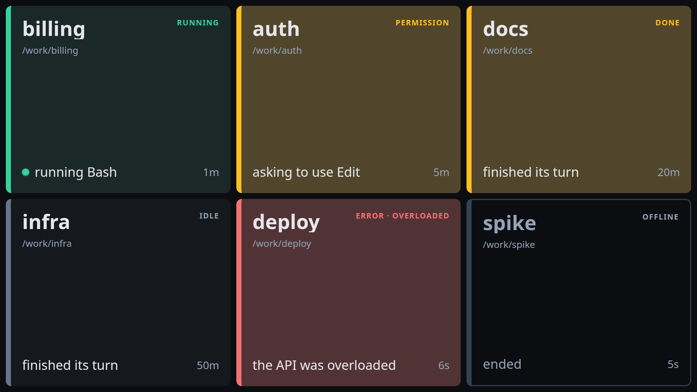

# hyper

A full-screen status board for the Claude Code sessions running on one machine. Each session gets a tile in a fixed grid cell showing its state, what it last did and how long ago. Click a tile to jump to the session's tmux pane; right-click an empty cell to start a new session there.



hyper is a client of [claude-control](https://github.com/dan-witt/claude-control), which tracks the sessions through Claude Code hooks and serves them over MCP. hyper never reads Claude Code's files itself.

## What the board shows

- **State** as a thick coloured left edge and a tinted background, readable from across a desk: running (green), waiting (amber, with the reason: permission, question, done), error (red), idle (grey), starting (blue), offline (hollow).
- **Last event** in words ("running Bash", "asking to use Edit", "finished its turn") and its age, plus an activity dot while a tool call is open.
- **Attention**: a tile pulses for a few seconds when it starts waiting or errors.
- **Stable layout**: tiles stay in the cells you put them in. New sessions take the first free cell, and `/clear` or `/resume` in the same terminal keeps the tile.

## Using it

| Gesture | Does |
| --- | --- |
| Click a tile | Switch tmux to the session's pane |
| Drag a tile | Move it to another cell; it swaps with a tile already there |
| Right-click a tile | Acknowledge (mute until the state changes), rename, edit description, copy project path, hide, remove (offline tiles) |
| Right-click an empty cell | Launch a session into that cell, show a hidden tile there, change the grid size |

Labels, descriptions, acknowledgements and hiding belong to the board; they never change the Claude session. The launch dialog takes a directory (with completion, starting at the last one used), an optional name and a multi-line prompt; `Ctrl+Enter` launches. The board does not switch tmux to the new session.

## Requirements

- Linux with an X11 desktop. The window is placed through RandR and EWMH; it was built on GNOME.
- [claude-control](https://github.com/dan-witt/claude-control), running, with its MCP token in `~/.config/claude-control/token`. hyper needs the `state_since`, `last_event_at`, `last_event_text` and `replaces` session fields, which are on claude-control's `dan/ech-18-board-session-fields` branch until it is merged.
- Python 3.12+ and [uv](https://docs.astral.sh/uv/).
- Node 24 and pnpm (`corepack enable`), to build the page.
- Google Chrome, for the board window.

## Install

```sh
cd web && pnpm install && pnpm build && cd ..
uv tool install --editable .
hyper install-service   # systemd user unit hyper.service on 127.0.0.1:7780, enabled and started
hyper install-window    # application launcher entry, plus autostart at login
hyper window            # the board, full screen on DP-2
```

`hyper window` opens the board as a Chrome app window with its own profile (`~/.local/state/hyper/chrome`), or moves the window already open. `--layout left|right` gives it half the monitor and `--monitor` picks another monitor by its RandR name (`xrandr --listmonitors`).

The service serves `web/dist` from this checkout. After pulling, run `pnpm build` for page changes, `systemctl --user restart hyper` for service changes, and `uv tool install --editable .` again when dependencies change.

## Configuration

Everything is optional. `~/.config/hyper/config.toml`:

```toml
port = 7780
daemon_url = "http://127.0.0.1:7777/mcp"
token_path = "~/.config/claude-control/token"
dev_origins = []                # other origins allowed to send requests, e.g. "http://localhost:5173"
browser = "google-chrome"
window_monitor = "DP-2"         # RandR monitor name
window_layout = "full"          # or "left" / "right": half the monitor
```

The grid size, tile positions, labels and the last launch directory are kept in `~/.local/state/hyper/board.json`.

## How it works

- **Board service** (Python, FastAPI): an MCP client of claude-control. It subscribes to the daemon's `sessions://` resource, also polls `list_sessions` every 2s for tool activity, and keeps the board state. The page gets a snapshot and then per-tile changes over server-sent events, with a heartbeat so it can tell the service being down from the daemon being down.
- **Page** (React, TypeScript, Vite): tiles sized with CSS container queries so they read the same at any screen size or grid shape; dnd-kit for drag, Radix for menus and dialogs. Its API types are generated from the service's OpenAPI schema.
- **Security**: the service listens on localhost only and holds claude-control's bearer token; nothing sent to the page contains it. Every request that changes something needs a localhost `Host`, the board's own `Origin` and `Content-Type: application/json`, so another web page open in the browser cannot launch sessions.

Design notes and decisions are in [`DESIGN.md`](DESIGN.md).

## API

| Endpoint | Does |
| --- | --- |
| `GET /api/board` | Grid, tiles (each with its session) and daemon connection status |
| `GET /api/events` | SSE: a `snapshot`, then `tile`, `tile_removed`, `grid` and `daemon` changes, and a `heartbeat` every 10s |
| `POST /api/sessions/{id}/focus` | Switch tmux to the session's pane; 409 with the daemon's message on failure |
| `POST /api/tiles/{id}/move` `{"cell": n}` | Put the tile in a cell, swapping with the tile there |
| `PATCH /api/tiles/{id}` `{"label": s, "description": s}` | Set the board label or description; a field left out is unchanged, null or blank clears it |
| `POST /api/tiles/{id}/acknowledge` | Mute a waiting or errored tile until its state changes |
| `POST /api/tiles/{id}/hide` | Take the tile off the grid |
| `POST /api/tiles/{id}/show` `{"cell": n \| null}` | Put a hidden tile in an empty cell, or the first free one |
| `DELETE /api/tiles/{id}` | Remove an offline session's tile |
| `GET /api/launch` | Launch dialog defaults: `{"cwd": <last directory launched in, or "~/">}` |
| `GET /api/dirs?path=p` | Directories completing the last component of `p` (absolute or `~`), each ending in `/` |
| `POST /api/launch` `{"cwd", "name"?, "prompt"?, "cell"?}` | Start a session through claude-control; its tile goes in `cell`. 409 with the daemon's message on failure |
| `POST /api/grid` `{"columns": c, "rows": r}` | Resize the grid; returns the size applied (rows grow to fit occupied cells) |

`uv run hyper openapi` prints the full schema.

## Development

```sh
uv sync
uv run pytest
uv run ruff check . && uv run ruff format --check .
uv run pyright
cd web && pnpm install
pnpm lint && pnpm test && pnpm build && pnpm e2e && pnpm check:api
```

- `uv run hyper serve --fake` runs the board over an in-process fake daemon with demo sessions. The tests and the Playwright suite use the same fake.
- `uv run hyper serve --dev` reads the live daemon and allows the Vite dev server (`pnpm dev` in `web/`, which proxies `/api` to port 7780). Launches are a dry run unless you add `--live-launch`.
- `pnpm check:api` fails when the page's generated types are stale against the service's models; `pnpm gen:api` regenerates them.

## License

GPL-3.0; see [`LICENSE`](LICENSE).
